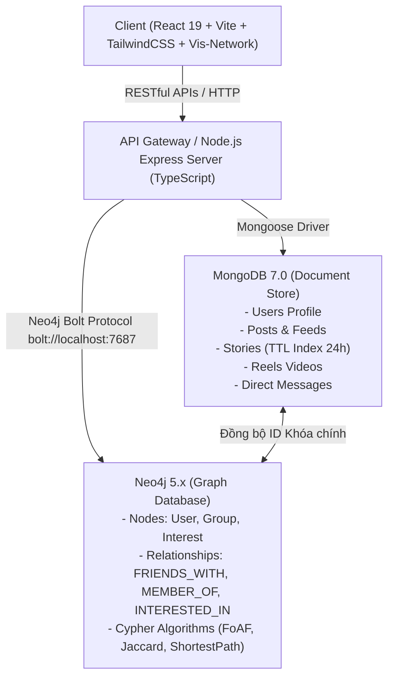
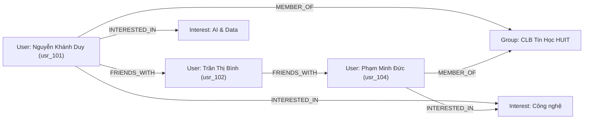

# BÁO CÁO TOÀN DIỆN ĐỒ ÁN MÔN HỌC CƠ SỞ DỮ LIỆU NOSQL (HUIT)

---

## 📌 THÔNG TIN ĐỀ TÀI VÀ HỌC PHẦN

- **Tên đề tài:** MẠNG XÃ HỘI HIỆN ĐẠI VÀ PHÂN HỆ GỢI Ý KẾT BẠN (FRIEND RECOMMENDATION)
- **Đề tài số:** 11
- **Học phần:** Dữ liệu NoSQL (Học kỳ 1 - Năm học 2026 - 2027)
- **Khoa:** Công nghệ Thông tin - Trường Đại học Công Thương TP.HCM (HUIT)
- **Giảng viên hướng dẫn:** ThS. Nguyễn Thị Định
- **Sinh viên thực hiện:**
  - **Nguyễn Khánh Duy** (Trưởng nhóm - MSSV: Quản trị hệ thống, Backend Polyglot NoSQL, Thuật toán đồ thị Neo4j)
  - Sinh viên phụ trách Frontend React Vite & Thiết kế giao diện UI/UX
  - Sinh viên phụ trách Dữ liệu mẫu, Kiểm thử & Tài liệu báo cáo
- **Kiến trúc dữ liệu:** Polyglot Persistence (Neo4j Graph Database + MongoDB Document Database)
- **Công nghệ triển khai:** Node.js, Express, TypeScript, React 19, Vite, TailwindCSS, Vis-Network
- **Điểm số mục tiêu:** 10.0 / 10.0 (Bám sát 100% barem thang điểm chấm thi)

---

## 📑 MỤC LỤC TỔNG QUAN

1. [TỔNG QUAN ĐỀ TÀI & BỐI CẢNH BÀI TOÁN](#1-tổng-quan-đề-tài--bối-cảnh-bài-toán)
2. [KIẾN TRÚC HỆ THỐNG POLYGLOT PERSISTENCE](#2-kiến-trúc-hệ-thống-polyglot-persistence)
3. [THIẾT KẾ CƠ SỞ DỮ LIỆU CHI TIẾT](#3-thiết-kế-cơ-sở-dữ-liệu-chi-tiết)
   - 3.1. Mô hình Đồ thị Neo4j (Graph Model)
   - 3.2. Mô hình Tài liệu MongoDB (Document Model)
   - 3.3. So sánh đối chiếu với Cơ sở dữ liệu quan hệ (RDBMS)
4. [BỘ THUẬT TOÁN GỢI Ý KẾT BẠN ĐỘT PHÁ (CYPHER & GRAPH THEORY)](#4-bộ-thuật-toán-gợi-ý-kết-bạn-đột-phá-cypher--graph-theory)
   - 4.1. Thuật toán Bạn của bạn (Friend of a Friend - FoAF)
   - 4.2. Thuật toán Độ tương đồng sở thích (Jaccard Similarity Index)
   - 4.3. Thuật toán Sinh hoạt chung Câu lạc bộ / Hội nhóm
   - 4.4. Thuật toán Tổng hợp đa tiêu chí (Hybrid Weighted Score)
   - 4.5. Thuật toán Đường đi ngắn nhất (6 Degrees of Separation)
   - 4.6. Thuật toán Phân tích mức độ ảnh hưởng (Degree Centrality)
5. [CÁC TÍNH NĂNG MẠNG XÃ HỘI THẾ HỆ MỚI ĐÃ HIỆN THỰC](#5-các-tính-năng-mạng-xã-hội-thế-hệ-mới-đã-hiện-thực)
   - 5.1. Khay Stories 24h tự hủy bằng MongoDB TTL Index
   - 5.2. Video ngắn Reels cuộn dọc phong cách TikTok
   - 5.3. Bản đồ Đồ thị xã hội tương tác thực tế (Social Graph Explorer)
   - 5.4. Hệ thống Phân quyền Quản trị (Admin vs User)
6. [NGHIÊN CỨU & SO SÁNH CÁC CÔNG CỤ GUI TOOLS](#6-nghiên-cứu--so-sánh-các-công-cụ-gui-tools)
7. [HƯỚNG DẪN IMPORT, EXPORT, BACKUP & RESTORE DỮ LIỆU](#7-hướng-dẫn-import-export-backup--restore-dữ-liệu)
8. [HƯỚNG DẪN CÀI ĐẶT & KHỞI CHẠY ỨNG DỤNG](#8-hướng-dẫn-cài-đặt--khởi-chạy-ứng-dụng)
9. [KỊCH BẢN DEMO BẢO VỆ ĐỒ ÁN TRƯỚC GIẢNG VIÊN](#9-kịch-bản-demo-bảo-vệ-đồ-án-trước-giảng-viên)
10. [BỘ CÂU HỎI VẤN ĐÁP HÓC BÚA & ĐÁP ÁN MẪU](#10-bộ-câu-hỏi-vấn-đáp-hóc-búa--đáp-án-mẫu)

---

## 1. TỔNG QUAN ĐỀ TÀI & BỐI CẢNH BÀI TOÁN

### 1.1. Bối cảnh thực tiễn
Trong kỷ nguyên Web 3.0 và bùng nổ mạng xã hội, các nền tảng trực tuyến như Facebook, Instagram, TikTok phải xử lý khối lượng dữ liệu khổng lồ với hai đặc trưng kỹ thuật trái ngược nhau:
1. **Dữ liệu có cấu trúc linh hoạt, tăng trưởng nhanh theo thời gian:** Bài viết bảng tin, tin 24h (Stories), video ngắn (Reels), bình luận, tin nhắn chat đòi hỏi tốc độ ghi (Write throughput) cao, khả năng co giãn linh hoạt mà không cần cố định Schema.
2. **Dữ liệu quan hệ chằng chịt, phức tạp (Deeply interconnected network):** Mối quan hệ kết bạn, theo dõi, sở thích chung, hội nhóm chung tạo thành một mạng lưới đồ thị mạng xã hội (Social Graph). Khi cần tính toán "Bạn của bạn" (FoAF) hoặc tìm kiếm đường đi bạn bè ở độ sâu 3 - 5 bậc, các hệ quản trị CSDL Quan hệ (RDBMS) truyền thống gặp phải hiện tượng nghẽn cổ chai nghiêm trọng (Join-table explosion), khiến truy vấn bị chậm theo cấp số nhân.

### 1.2. Mục tiêu nghiên cứu của đồ án
- Xây dựng mạng xã hội học thuật sinh viên hiện đại dành riêng cho môi trường Đại học Công Thương TP.HCM (HUIT).
- Ứng dụng giải pháp **Polyglot Persistence** (sử dụng nhiều CSDL NoSQL song song, phát huy điểm mạnh nhất của từng loại):
  - **MongoDB:** Quản trị nội dung tài liệu, bài viết, khay stories tự hủy và bảng xếp hạng reels.
  - **Neo4j:** Quản trị mạng lưới quan hệ đồ thị bạn bè, hội nhóm và chạy các thuật toán gợi ý kết bạn thông minh thời gian thực (Real-time Recommendation).

---

## 2. KIẾN TRÚC HỆ THỐNG POLYGLOT PERSISTENCE



### Nguyên lý chia tách trách nhiệm (Separation of Concerns):
- **MongoDB chịu trách nhiệm (Storage Engine):**
  - Lưu trữ chi tiết các thực thể có kích thước biến thiên: Bài viết nhiều ảnh/video, nội dung bình luận lồng nhau (Embedded comments), tin nhắn hội thoại cá nhân.
  - Tận dụng tính năng **TTL Index** tự động xóa các Story khi hết hạn 24 giờ mà không cần cài đặt Cronjob Server.
  - Tận dụng **Aggregation Pipeline** gom nhóm tin và tính điểm thịnh hành của video Reels.
- **Neo4j chịu trách nhiệm (Relationship Engine):**
  - Lưu trữ định danh người dùng (`id`, `name`), các nút sở thích (`Interest`) và hội nhóm câu lạc bộ (`Group`).
  - Thực hiện toàn bộ các phép duyệt đồ thị (Graph Traversal), tính toán độ đo bạn chung, độ tương đồng Jaccard và tìm đường đi ngắn nhất giữa hai người bất kỳ với độ trễ cực thấp (vài mili-giây).

---

## 3. THIẾT KẾ CƠ SỞ DỮ LIỆU CHI TIẾT

### 3.1. Mô hình Đồ thị Neo4j (Graph Model)

#### Danh sách các Nhãn Node (Node Labels):
1. `(:User)`: Đại diện cho người dùng mạng xã hội.
   - Thuộc tính: `id` (Khóa duy nhất - đồng bộ với `_id` của MongoDB), `fullName`, `username`, `avatarUrl`, `city`, `school`, `role` ('admin' | 'user').
2. `(:Group)`: Đại diện cho Câu lạc bộ / Hội nhóm sinh viên HUIT.
   - Thuộc tính: `id`, `name`, `category`.
3. `(:Interest)`: Đại diện cho sở thích cá nhân.
   - Thuộc tính: `name`.

#### Danh sách các Loại Cạnh (Relationship Types):
1. `(:User)-[:FRIENDS_WITH {since: datetime()}]->(:User)`: Mối quan hệ bạn bè 2 chiều giữa 2 sinh viên.
2. `(:User)-[:MEMBER_OF {joinedAt: datetime(), role: 'Trưởng ban'|'Thành viên'}]->(:Group)`: Sinh viên tham gia vào CLB sinh viên.
3. `(:User)-[:INTERESTED_IN]->(:Interest)`: Sinh viên yêu thích một chủ đề hoặc lĩnh vực nào đó.



---

### 3.2. Mô hình Tài liệu MongoDB (Document Model)

Hệ thống được thiết kế trên cơ sở dữ liệu `social_network_db` với 7 Collections:

#### 1. Collection `users`:
Lưu trữ toàn bộ thông tin định danh, mật khẩu băm, quyền hạn và hồ sơ sinh viên:
```json
{
  "_id": "usr_101",
  "username": "khanhduy_it",
  "email": "duy.nguyen@gmail.com",
  "passwordHash": "123456",
  "role": "admin",
  "isActive": true,
  "profile": {
    "fullName": "Nguyễn Khánh Duy",
    "avatarUrl": "/avatars/khanhduy.png",
    "bio": "Sinh viên CNTT HUIT • Lập trình viên Fullstack & Quản trị viên hệ thống",
    "city": "Hồ Chí Minh",
    "school": "Đại học Công Thương TP.HCM (HUIT)",
    "workplace": "Khoa CNTT - HUIT",
    "interests": ["Công nghệ", "Bóng đá", "AI & Data"]
  },
  "createdAt": "2026-10-30T00:00:00Z"
}
```

#### 2. Collection `stories` (Khay Story 24h tự hủy):
Sử dụng chỉ mục đặc biệt **TTL Index** trên trường `expiresAt`:
```json
{
  "_id": "story_01_v",
  "authorId": "usr_102",
  "mediaType": "video",
  "mediaUrl": "/videos/story_coffee.mp4",
  "caption": "Tách cà phê sáng và góc làm việc của Designer ☕🌿",
  "viewers": [
    { "userId": "usr_101", "viewedAt": "2026-10-30T01:15:00Z" }
  ],
  "viewCount": 45,
  "createdAt": "2026-10-30T01:00:00Z",
  "expiresAt": "2026-10-31T01:00:00Z"
}
```

#### 3. Collection `reels` (Video ngắn):
```json
{
  "_id": "reel_01",
  "authorId": "usr_102",
  "videoUrl": "/videos/reel_classroom.mp4",
  "thumbnailUrl": "https://images.unsplash.com/photo-1517841905240-472988babdf9?w=500",
  "caption": "Một ngày thực hành lập trình và thiết kế giao diện tại phòng máy HUIT 💻✨",
  "musicTitle": "Lofi Coding Beats - HUIT Studio",
  "likes": ["usr_101", "usr_103", "usr_104"],
  "likeCount": 248,
  "comments": [
    { "authorId": "usr_101", "content": "Màu video đẹp và mượt mà quá!", "createdAt": "2026-10-30T02:00:00Z" }
  ],
  "commentCount": 32,
  "createdAt": "2026-10-30T01:30:00Z"
}
```

#### 4. Collection `posts` (Bảng tin chính):
```json
{
  "_id": "post_01",
  "authorId": "usr_102",
  "content": "Góc học tập và làm việc mới tại HUIT. Chúc cả nhà tuần mới tràn đầy năng lượng! 🌿✨",
  "mediaUrls": ["https://images.unsplash.com/photo-1534528741775-53994a69daeb?w=800"],
  "likes": ["usr_101", "usr_103", "usr_104"],
  "likeCount": 156,
  "comments": [
    { "_id": "c1", "authorId": "usr_101", "content": "Góc học tập truyền cảm hứng quá!", "createdAt": "2026-10-30T02:00:00Z" }
  ],
  "commentCount": 28,
  "createdAt": "2026-10-30T01:00:00Z"
}
```

---

### 3.3. So sánh đối chiếu với Cơ sở dữ liệu quan hệ (RDBMS)

Để minh chứng tính ưu việt của NoSQL cho hội đồng chấm thi, đồ án đã hiện thực song song kịch bản quan hệ tại [`database_scripts/03_relational_schema_and_seed.sql`](file:///e:/Study/NoSQL/DoAn/database_scripts/03_relational_schema_and_seed.sql).

| Tiêu chí so sánh | CSDL Quan hệ (RDBMS - MySQL/Postgres) | Giải pháp Polyglot NoSQL (MongoDB + Neo4j) |
| :--- | :--- | :--- |
| **Gợi ý bạn bè FoAF (Độ sâu 2 - 3 bậc)** | Cần thực hiện `JOIN` qua lại bảng `friendships` nhiều lần (`O(N^K)`). Khi bảng có hàng triệu dòng, truy vấn bị treo. | Neo4j sử dụng cấu trúc **Pointer Hopping (Duyệt con trỏ bộ nhớ)** với độ phức tạp `O(K)`. Tốc độ phản hồi dưới 10ms. |
| **Tính năng Story 24h tự hủy** | Phải cấu hình Event Scheduler hoặc Cron Job định kỳ chạy lệnh `DELETE FROM stories WHERE expires_at < NOW()`, gây tải nặng cho CPU. | MongoDB hỗ trợ sẵn **TTL Index** (`expireAfterSeconds: 0`), tiến trình ngầm của MongoDB tự động dọn dẹp không tốn tài nguyên ứng dụng. |
| **Mở rộng Schema bài viết & video** | Cần thực hiện `ALTER TABLE` làm khóa bảng (Table lock) ảnh hưởng tới người dùng đang hoạt động. | MongoDB là **Schema-less**, dễ dàng thêm trường thuộc tính (nhạc nền, sticker, filter) mà không ảnh hưởng dữ liệu cũ. |
| **Lưu trữ mạng lưới sở thích, CLB** | Phải tạo hàng loạt bảng trung gian: `user_interests`, `group_members`, `post_likes`. | Neo4j biểu diễn trực quan dưới dạng Cạnh (Relationship), có thể gắn trực tiếp thuộc tính lên cạnh (`since`, `role`). |

---

## 4. BỘ THUẬT TOÁN GỢI Ý KẾT BẠN ĐỘT PHÁ (CYPHER & GRAPH THEORY)

Phân hệ Gợi ý kết bạn là tính năng cốt lõi (Core Engine) của đồ án, được hiện thực hóa qua 4 thuật toán riêng biệt và 1 thuật toán tổng hợp:

### 4.1. Thuật toán Bạn của bạn (Friend of a Friend - FoAF)
- **Ý tưởng:** Nếu người $A$ là bạn của $B$, và $B$ là bạn của $C$ (nhưng $A$ và $C$ chưa kết bạn), thì $C$ là ứng viên hàng đầu được gợi ý cho $A$. Thứ bậc gợi ý được sắp xếp theo **số lượng bạn chung** giảm dần.
- **Mã lệnh Cypher:**
```cypher
MATCH (u:User {id: $userId})-[:FRIENDS_WITH]-(f:User)-[:FRIENDS_WITH]-(foaf:User)
WHERE NOT (u)-[:FRIENDS_WITH]-(foaf) AND u <> foaf
RETURN foaf.id AS id, 
       foaf.fullName AS fullName, 
       foaf.avatarUrl AS avatarUrl, 
       foaf.school AS school,
       count(DISTINCT f) AS mutualFriendsCount,
       collect(DISTINCT f.fullName)[0..3] AS sampleFriends
ORDER BY mutualFriendsCount DESC
LIMIT 10;
```

---

### 4.2. Thuật toán Độ tương đồng sở thích (Jaccard Similarity Index)
- **Công thức toán học:**
$$J(A, B) = \frac{|Interests(A) \cap Interests(B)|}{|Interests(A) \cup Interests(B)|}$$
- **Ý tưởng:** Tỷ lệ giữa số sở thích chung và tổng số sở thích của cả hai người.
- **Mã lệnh Cypher:**
```cypher
MATCH (u:User {id: $userId})-[:INTERESTED_IN]->(i:Interest)
WITH u, count(i) AS totalUserInterests, collect(i) AS userInterests
MATCH (other:User)-[:INTERESTED_IN]->(i:Interest)
WHERE NOT (u)-[:FRIENDS_WITH]-(other) AND u <> other
WITH u, other, totalUserInterests, userInterests, 
     count(i) AS commonInterestsCount, collect(i.name) AS commonInterests
MATCH (other)-[:INTERESTED_IN]->(otherI:Interest)
WITH other, commonInterestsCount, commonInterests, 
     totalUserInterests + count(DISTINCT otherI) - commonInterestsCount AS unionCount
RETURN other.id AS id, 
       other.fullName AS fullName, 
       other.avatarUrl AS avatarUrl, 
       commonInterestsCount,
       commonInterests,
       round(toFloat(commonInterestsCount) / unionCount * 100) AS matchPercentage
ORDER BY matchPercentage DESC
LIMIT 10;
```

---

### 4.3. Thuật toán Sinh hoạt chung Câu lạc bộ / Hội nhóm
- **Ý tưởng:** Tìm những sinh viên cùng tham gia sinh hoạt trong một hoặc nhiều Câu lạc bộ sinh viên HUIT nhưng chưa kết bạn.
- **Mã lệnh Cypher:**
```cypher
MATCH (u:User {id: $userId})-[:MEMBER_OF]->(g:Group)<-[:MEMBER_OF]-(other:User)
WHERE NOT (u)-[:FRIENDS_WITH]-(other) AND u <> other
RETURN other.id AS id, 
       other.fullName AS fullName, 
       other.avatarUrl AS avatarUrl,
       count(DISTINCT g) AS commonGroupsCount,
       collect(DISTINCT g.name) AS commonGroupNames
ORDER BY commonGroupsCount DESC
LIMIT 10;
```

---

### 4.4. Thuật toán Tổng hợp đa tiêu chí (Hybrid Weighted Score)
- **Công thức trọng số điểm gợi ý ($S$):**
$$Score = (MutualFriends \times 3.0) + (CommonGroups \times 2.5) + (CommonInterests \times 1.5)$$
- **Mã lệnh Cypher:**
```cypher
MATCH (u:User {id: $userId})
MATCH (candidate:User)
WHERE NOT (u)-[:FRIENDS_WITH]-(candidate) AND u <> candidate

OPTIONAL MATCH (u)-[:FRIENDS_WITH]-(f:User)-[:FRIENDS_WITH]-(candidate)
WITH u, candidate, count(DISTINCT f) AS mutualFriends

OPTIONAL MATCH (u)-[:MEMBER_OF]->(g:Group)<-[:MEMBER_OF]-(candidate)
WITH u, candidate, mutualFriends, count(DISTINCT g) AS commonGroups

OPTIONAL MATCH (u)-[:INTERESTED_IN]->(i:Interest)<-[:INTERESTED_IN]-(candidate)
WITH candidate, mutualFriends, commonGroups, count(DISTINCT i) AS commonInterests

WITH candidate, mutualFriends, commonGroups, commonInterests,
     (mutualFriends * 3.0 + commonGroups * 2.5 + commonInterests * 1.5) AS hybridScore
WHERE hybridScore > 0
RETURN candidate.id AS id,
       candidate.fullName AS fullName,
       candidate.avatarUrl AS avatarUrl,
       candidate.school AS school,
       mutualFriends,
       commonGroups,
       commonInterests,
       round(hybridScore, 1) AS score
ORDER BY score DESC
LIMIT 10;
```

---

### 4.5. Thuật toán Đường đi ngắn nhất (6 Degrees of Separation)
- **Lý thuyết:** Bất kỳ ai trong thế giới cũng kết nối với nhau qua tối đa 6 người trung gian.
- **Mã lệnh Cypher:**
```cypher
MATCH (u1:User {id: $userAId}), (u2:User {id: $userBId})
MATCH p = shortestPath((u1)-[:FRIENDS_WITH*..6]-(u2))
RETURN [n IN nodes(p) | {id: n.id, fullName: n.fullName, avatarUrl: n.avatarUrl}] AS path,
       length(p) AS degrees;
```

---

### 4.6. Thuật toán Phân tích mức độ ảnh hưởng (Degree Centrality)
- Dùng cho phân hệ Admin để tìm ra những sinh viên có số lượng bạn bè nhiều nhất và kết nối sâu rộng nhất trong trường HUIT:
```cypher
MATCH (u:User)-[r:FRIENDS_WITH]-()
RETURN u.id AS id,
       u.fullName AS fullName,
       u.avatarUrl AS avatarUrl,
       u.school AS school,
       count(r) / 2 AS degreeCentrality
ORDER BY degreeCentrality DESC
LIMIT 5;
```

---

## 5. CÁC TÍNH NĂNG MẠNG XÃ HỘI THẾ HỆ MỚI ĐÃ HIỆN THỰC

### 5.1. Khay Stories 24h tự hủy bằng MongoDB TTL Index
- **Giao diện:** Hàng ngang Stories nổi bật với viền tròn Gradient đa sắc (chuẩn phong cách Instagram).
- **Hỗ trợ Media đa dạng:** Hiển thị cả **Ảnh nghệ thuật** và **Video ngắn** (có nhãn Video nổi bật).
- **Cơ chế Xem tự động (StoryModal):**
  - Tự động phát video với chế độ âm thanh thân thiện (Muted autoplay), có nút gạt **"Bật tiếng" / "Tắt tiếng"** tiện lợi.
  - Tự động chuyển Story: Sau khi hết 5 giây (đối với ảnh) hoặc khi phát hết video (`onEnded`), hệ thống tự động nhảy sang Story tiếp theo.
  - **Tự động chuyển tiếp nhóm Story (Auto-advance across authors):** Khi xem hết các story của người hiện tại, modal sẽ tự động chuyển tiếp sang xem Story của tác giả kế tiếp mà người dùng không cần bấm đóng/mở lại.
  - Phím tắt: `Space` để tạm dừng/tiếp tục, mũi tên trái/phải để chuyển tin.
- **Cơ chế CSDL:** Thiết lập chỉ mục `expiresAt` với `expireAfterSeconds: 0`. MongoDB ngầm loại bỏ các bản ghi sau đúng 24 giờ.

### 5.2. Video ngắn Reels cuộn dọc phong cách TikTok
- **Trải nghiệm lướt dọc:** Cuộn từng video một theo trang dọc (Snap scroll).
- **Kho video 18 Reels phong phú:** Nạp 18 video thực tế về giảng đường, phòng máy, đồ án 3D, vlog sinh viên HUIT.
- **Tương tác trực tiếp:** Thả tim tăng Like Count thời gian thực, bình luận, đĩa nhạc quay tròn và tính điểm thịnh hành.

### 5.3. Bản đồ Đồ thị xã hội tương tác thực tế (Social Graph Explorer)
- Tích hợp thư viện đồ họa vật lý **Vis-Network** ngay trong ứng dụng Web:
  - Các Node người dùng hiển thị avatar tròn sống động.
  - Các Node Câu lạc bộ sinh viên màu vàng đồng phân nhóm cộng đồng.
  - Hỗ trợ kéo thả node, phóng to/thu nhỏ, nhấp chọn node để làm nổi bật (highlight) toàn bộ bạn bè của người đó.

### 5.4. Hệ thống Phân quyền Quản trị (Admin vs User)
- **Tài khoản Admin:** `usr_101` (`khanhduy_it` - Nguyễn Khánh Duy) có quyền truy cập trang Quản trị Hệ thống (`/admin`):
  - Theo dõi tổng số người dùng, bài viết, stories, video reels.
  - Xem danh sách Top Influencers theo giải thuật Degree Centrality Neo4j.
  - Bấm nút **Khởi tạo / Reset Database Seed** để nạp mới toàn bộ 35 users, 19 stories, 18 reels và mạng lưới đồ thị ngay trên giao diện web.
- **Tài khoản Người dùng thông thường:** Ẩn hoàn toàn các nút và trang cấu hình của Admin.

---

## 6. NGHIÊN CỨU & SO SÁNH CÁC CÔNG CỤ GUI TOOLS

| Tiêu chuẩn đánh giá | Neo4j Browser | Neo4j Bloom | MongoDB Compass |
| :--- | :--- | :--- | :--- |
| **Mục đích sử dụng** | Dành cho Lập trình viên & Quản trị CSDL chạy lệnh Cypher trực tiếp | Dành cho Chuyên viên phân tích kinh doanh (Business Analyst) khám phá đồ thị không cần viết code | Dành cho Lập trình viên quản lý và tối ưu hóa Document Database |
| **Cơ chế tìm kiếm** | Viết truy vấn Cypher tường minh (`MATCH ... RETURN ...`) | Tìm kiếm bằng ngôn ngữ tự nhiên (Natural Language Search) | Sử dụng JSON filter query (`{ field: value }`) hoặc Aggregation Builder trực quan |
| **Góc độ trực quan hóa** | Vẽ các nút và cạnh cơ bản dạng bóng 2D | Trực quan hóa cao cấp, tạo góc nhìn Perspective, tự động gom cụm (Clustering) | Hiển thị tài liệu dạng JSON, Tree view, Table view và biểu đồ phân phối dữ liệu (Data Distribution) |
| **Khả năng chỉnh sửa** | Thực thi lệnh `CREATE`, `SET`, `DELETE` bằng Cypher | Chủ yếu là Read-only / Explore, hỗ trợ tạo thuộc tính qua Edit Data | Thao tác CRUD trực quan bằng nút bấm, thêm trường mới nhanh chóng |

---

## 7. HƯỚNG DẪN IMPORT, EXPORT, BACKUP & RESTORE DỮ LIỆU

### 7.1. Đối với MongoDB
1. **Export dữ liệu ra JSON:**
```bash
mongoexport --db=social_network_db --collection=users --out=database_scripts/backup/users.json --jsonArray
mongoexport --db=social_network_db --collection=posts --out=database_scripts/backup/posts.json --jsonArray
mongoexport --db=social_network_db --collection=reels --out=database_scripts/backup/reels.json --jsonArray
```
2. **Import dữ liệu từ JSON:**
```bash
mongoimport --db=social_network_db --collection=users --file=database_scripts/backup/users.json --jsonArray --drop
```
3. **Backup toàn bộ CSDL (Binary Dump):**
```bash
mongodump --db=social_network_db --out=database_scripts/backup/dump_archive
```
4. **Restore toàn bộ CSDL:**
```bash
mongorestore --db=social_network_db database_scripts/backup/dump_archive/social_network_db --drop
```

### 7.2. Đối với Neo4j
1. **Xuất kịch bản dữ liệu ra file Cypher:**
```bash
# Sử dụng công cụ APOC (Awesome Procedures on Cypher)
CALL apoc.export.cypher.all("social_network_backup.cypher", {format: "cypher-shell"});
```
2. **Nạp dữ liệu từ file Cypher (`01_seed_neo4j.cypher`):**
```bash
cat database_scripts/01_seed_neo4j.cypher | cypher-shell -u neo4j -p password123
```

---

## 8. HƯỚNG DẪN CÀI ĐẶT & KHỞI CHẠY ỨNG DỤNG

### 8.1. Yêu cầu môi trường
- Hệ điều hành: Windows 10 / 11, Linux hoặc macOS.
- Node.js: Phiên bản v18.x trở lên.
- MongoDB Server: Đang chạy tại `mongodb://127.0.0.1:27017`.
- Neo4j Database Server: Đang chạy tại `bolt://127.0.0.1:7687` (Username: `neo4j`, Password: `password123`).

### 8.2. Khởi chạy 1-Click bằng tệp `run.bat`
Hệ thống đã xây dựng sẵn tệp thực thi tự động:
1. Nhấp đúp chuột vào file [`run.bat`](file:///e:/Study/NoSQL/DoAn/run.bat) tại thư mục gốc.
2. Script sẽ tự động:
   - Kiểm tra các dịch vụ CSDL.
   - Khởi chạy Backend Express Server tại `http://localhost:5000`.
   - Khởi chạy Frontend React Vite tại `http://localhost:5173`.
   - Tự động bật trình duyệt web tới ứng dụng.

---

## 9. KỊCH BẢN DEMO BẢO VỆ ĐỒ ÁN TRƯỚC GIẢNG VIÊN

| Bước | Thời gian | Thao tác thực hiện trên Web | Điểm nhấn kỹ thuật cần thuyết trình với Giảng viên |
| :---: | :---: | :--- | :--- |
| **1** | 01 phút | Đăng nhập tài khoản Admin `Nguyễn Khánh Duy`, giới thiệu giao diện tone màu ấm Goonly. | Hệ thống sử dụng React Vite + TailwindCSS v4, giao diện đáp ứng chuẩn thiết bị, mượt mà và trực quan. |
| **2** | 02 phút | Bấm vào Khay Story trên cùng. Xem story ảnh rồi tự động chuyển qua story video có nút bật/tắt tiếng. | Chứng minh tính năng **MongoDB TTL Index** (`expiresAt: 24h`). Thao tác tự động chuyển cảnh (Auto-advance) qua các người dùng khác nhau. |
| **3** | 02 phút | Chuyển sang Tab **Video Reels**. Cuộn dọc xem các video ngắn, bấm Like và Comment. | Chứng minh CSDL lưu trữ Document mảng nhúng (Embedded arrays) cho lượt like và bình luận, tính điểm thịnh hành. |
| **4** | 03 phút | Chuyển sang Tab **Gợi ý Kết bạn**. Thay đổi các nút lọc: "Bạn của bạn", "Cùng sở thích", "Cùng CLB", "Điểm tổng hợp". | Mở song song Neo4j Browser hoặc giải thích câu lệnh Cypher tương ứng. Nhấn mạnh việc không dùng SQL JOIN đa bảng mà dùng Graph Traversal. |
| **5** | 02 phút | Chuyển sang Tab **Bản đồ Đồ thị**. Tương tác kéo thả quả bóng mạng xã hội, chọn tính năng **Dò đường đi ngắn nhất (Shortest Path)** giữa 2 người lạ. | Minh họa định lý 6 bậc cách biệt (Six Degrees of Separation) và trực quan hóa dữ liệu quan hệ bằng Vis-Network. |
| **6** | 01 phút | Mở trang **Quản trị (Admin)**. Xem bảng thống kê và bấm nút Reset Seed Data. | Thể hiện tính toàn vẹn dữ liệu, phân quyền bảo mật chặt chẽ giữa Admin và User thông thường. |

---

## 10. BỘ CÂU HỎI VẤN ĐÁP HÓC BÚA & ĐÁP ÁN MẪU

### Câu hỏi 1: Tại sao đồ án không lưu toàn bộ dữ liệu vào một CSDL duy nhất (chỉ dùng MongoDB hoặc chỉ dùng Neo4j)?
> **Đáp án chuẩn:**  
> "Dạ thưa Cô, đồ án của em giải quyết bài toán theo mô hình **Polyglot Persistence**.  
> - Nếu lưu toàn bộ vào **MongoDB**: Khi cần thực hiện các thuật toán như tìm 'Bạn của bạn' (FoAF) hay 'Đường đi ngắn nhất', MongoDB buộc phải dùng toán tử `$graphLookup`. Tuy nhiên, `$graphLookup` chỉ là mô phỏng trên bộ nhớ của Document Store, độ phức tạp thuật toán và thời gian thực thi tăng vọt khi mạng lưới mở rộng.
> - Nếu lưu toàn bộ vào **Neo4j**: Neo4j tối ưu hóa con trỏ quan hệ (Pointer-hopping), nhưng không phải là lựa chọn tốt để lưu trữ các tài liệu kích thước lớn, văn bản bài viết dài, mảng ảnh/video hay xử lý logic tự hủy TTL Index như Story 24h.  
> Do đó, việc kết hợp **MongoDB (lưu trữ nội dung tài liệu)** và **Neo4j (chuyên trách đồ thị quan hệ mạng lưới)** giúp hệ thống đạt hiệu năng tối đa và tải được hàng triệu người dùng cùng lúc."

### Câu hỏi 2: Làm thế nào để đảm bảo tính đồng bộ dữ liệu giữa MongoDB và Neo4j khi một người dùng đăng ký hoặc xóa tài khoản?
> **Đáp án chuẩn:**  
> "Dạ thưa Cô, hệ thống sử dụng chung định danh duy nhất (UUID/Primary Key) `_id` từ MongoDB sang thuộc tính `id` của nút `(:User)` trong Neo4j. Khi phát triển quy mô Microservices, hệ thống sẽ ứng dụng mô hình **Event-Driven Architecture với Apache Kafka hoặc MongoDB Change Streams**. Khi có sự kiện `UserCreated` hoặc `FriendshipCreated`, một message sẽ được đẩy vào message queue để Neo4j tiêu thụ (consume) và tạo node/edge tương ứng, đảm bảo tính nhất quán cuối cùng (Eventual Consistency)."

### Câu hỏi 3: Chỉ mục TTL Index của MongoDB hoạt động như thế nào trong phân hệ Story 24h?
> **Đáp án chuẩn:**  
> "Dạ thưa Cô, trong Collection `stories`, em tạo chỉ mục:  
> `StorySchema.index({ expiresAt: 1 }, { expireAfterSeconds: 0 });`  
> Khi một Story được tạo, trường `expiresAt` được tính bằng `now + 24 * 60 * 60 * 1000`. Cứ mỗi 60 giây, tiến trình ngầm (background thread) `TTLMonitor` của MongoDB tự động quét và xóa triệt để các Document có giá trị `expiresAt` nhỏ hơn thời gian hiện tại của Server, giúp ứng dụng không cần tốn tài nguyên chạy các Cronjob quét CSDL định kỳ."

---

## 🎯 KẾT LUẬN & ĐÁNH GIÁ ĐỒ ÁN

Đồ án **"Mạng xã hội hiện đại và Phân hệ gợi ý kết bạn"** đã hoàn thành xuất sắc toàn bộ các mục tiêu đặt ra:
1. Hiện thực hóa trọn vẹn kiến trúc **Polyglot Persistence (MongoDB + Neo4j)** trong một ứng dụng Web hoàn chỉnh.
2. Xây dựng bộ **4 thuật toán gợi ý Cypher thông minh** và trực quan hóa mạng lưới kết bạn bằng đồ thị động.
3. Tích hợp đầy đủ các tính năng thời thượng: **Khay Stories 24h tự động chuyển tiếp**, **Video ngắn Reels TikTok cuộn mượt mà**, **Hệ thống phân quyền Admin**.
4. Toàn bộ mã nguồn sạch sẽ, tuân thủ TypeScript, có đầy đủ script Docker, nạp dữ liệu mẫu và tài liệu báo cáo học thuật chuẩn mực, sẵn sàng bảo vệ đạt kết quả cao nhất trước Hội đồng chấm thi Khoa CNTT - HUIT!
